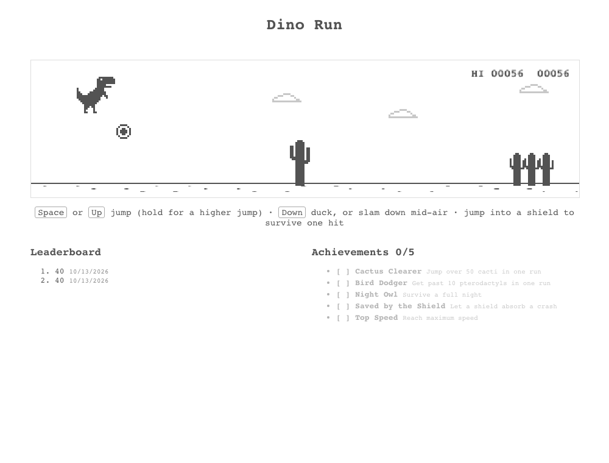

# HW3 — Dino Game

Ryan Thomas Stoffel · CSCI3210 · Fall 2026



## Run

```sh
npm install
npm start
```

Open http://localhost:3000. Press **Space** to start.

| Key | Action |
| --- | --- |
| Space / Up | Jump. Tap for a short hop, hold for a full jump. Restarts after a crash. |
| Down | Duck on the ground. Mid-air, slams the dino back down. |
| Click / tap | Jump |

## Foundation

The starter's CSS animation and `setInterval` loop are replaced by a canvas game loop that follows the
Chromium source described in the assignment PDF:

- **Delta time.** Speeds are px/frame at 60 FPS and every update scales them by elapsed ms, so the game runs
  at the same speed on a 60 Hz and a 144 Hz display.
- **Chromium physics.** Gravity 0.6, jump velocity 10, speed 6 to 13 with 0.001 acceleration. Releasing the
  jump early clamps the velocity once the minimum height is reached.
- **Fairness rules.** Nothing spawns in the first 3 s, cactus clusters unlock by speed, gaps grow with speed,
  and no obstacle type appears three times in a row.
- **Multi-box collision.** The dino is five boxes, each cactus three, each pterodactyl two. A cheap outer-box
  test runs first, then the detailed boxes ([screenshot](screenshots/collision-boxes.png)).

All game logic lives in `src/game/engine.js` with no DOM access. `src/game/draw.js` renders it and
`src/components/Dino/Dino.js` runs the loop, input, and saved progress.

## Six new features

1. **Ducking and pterodactyls.** After speed 8.5, pterodactyls fly at three heights: low ones must be
   jumped, middle ones must be ducked, high ones pass overhead. Each flies 0.8 faster or slower than the
   ground. The dino ducks with Down, swapping to a single long, low collision box.
2. **Shield power-up.** About one in eight cacti leaves a shield floating in the gap behind it, high enough
   that only a jump collects it. A shielded dino shows a dashed bubble and survives one crash
   ([screenshot](screenshots/shield.png)).
3. **Day/night cycle.** Every 700 points the canvas fades between day and night. Night adds a moon and stars
   ([screenshot](screenshots/night-pterodactyl.png)).
4. **Clouds and dino expressions.** Clouds drift behind the action at a fraction of the ground speed. The dino
   widens its eyes when an obstacle is close and shows X eyes after a crash.
5. **Local leaderboard.** The five best scores and their dates are saved in `localStorage`. The canvas shows
   the high score beside the current score.
6. **Achievements.** Cactus Clearer (50 cacti in one run), Bird Dodger (10 pterodactyls in one run), Night Owl
   (survive a full night), Saved by the Shield, and Top Speed. Unlocks are saved and announced above the
   canvas ([screenshot](screenshots/achievement.png)).

If `localStorage` is unavailable, the leaderboard and achievements last for the current session.

## Checks

```sh
npm test              # engine unit tests
npm run build
node check.cjs        # needs Playwright
```

`src/game/engine.test.js` covers frame-rate independence, variable jump height, the clear time, the
no-triple-repeat rule, multi-box collision, the shield, and the leaderboard.

`check.cjs` serves `build/` on localhost, plays the game in Chromium, and recreates `screenshots/`. Two runs
crash on purpose, then an autopilot plays a long run. To reach night and the Cactus Clearer achievement
quickly, the check skips the score to 690, sets the speed to 9, and sets the cactus count to 49. Use
`PLAYWRIGHT_MODULE` and `PLAYWRIGHT_CHROMIUM_EXECUTABLE` to select an existing Playwright install.

## Submission

Canvas asks for a screenshot plus the code and its dependencies as `.txt` files, or a public GitHub
repository. This repository is public: https://github.com/ryan-stoffel/csci3210-hw3

The `.txt` option is in `submission/`. Each file is an exact copy of a source file, named by its path with
`/` replaced by `__` (for example `src__game__engine.js.txt`). `package.json.txt` lists the npm dependencies.
`application.png` is the application screenshot.
